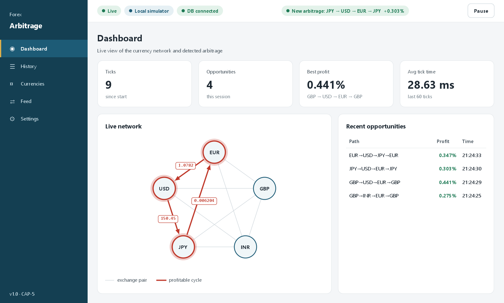
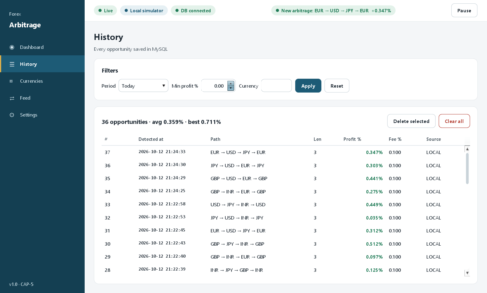
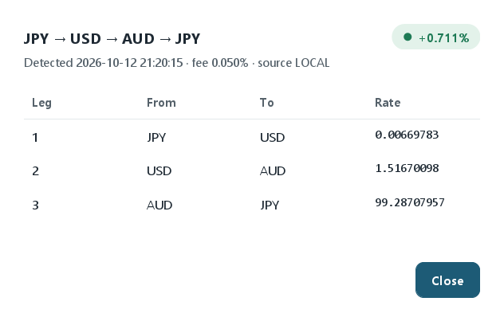
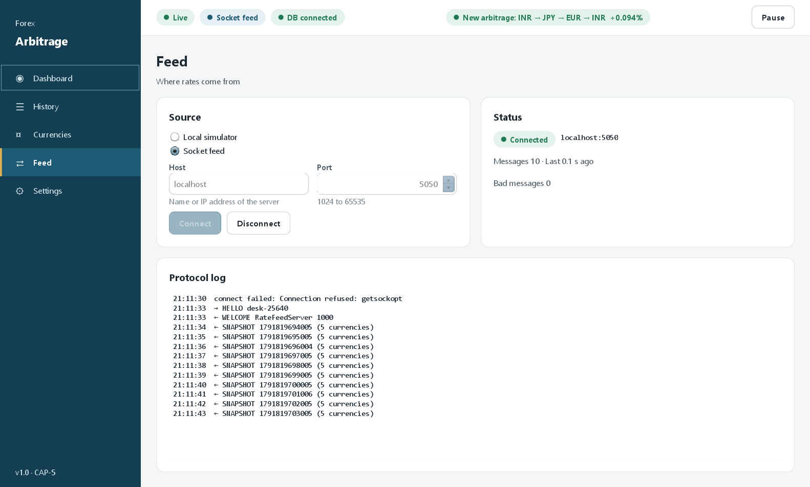
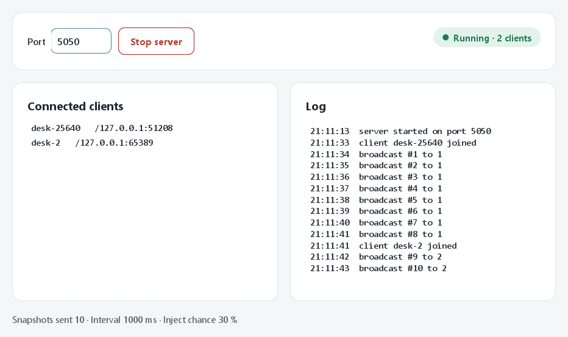
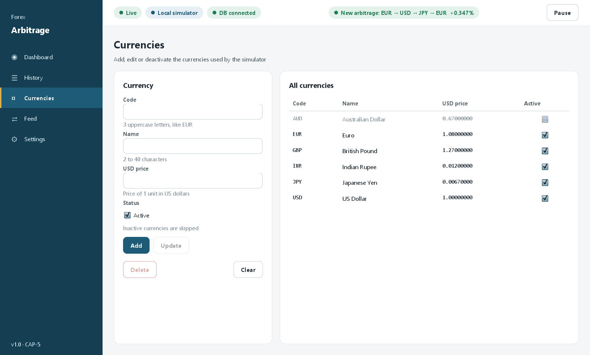
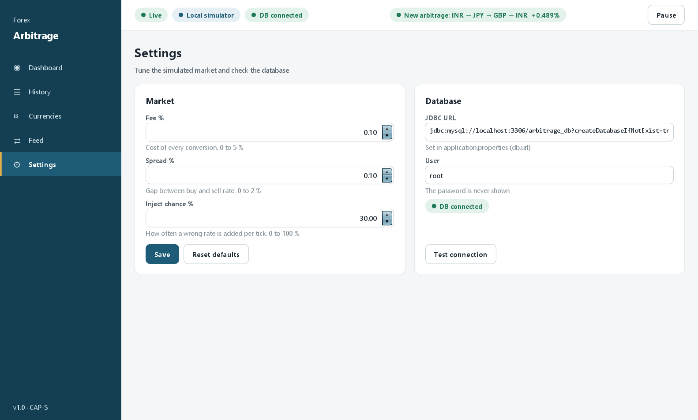

**Bellman-Ford Triangular Arbitrage Detector and Real-time Forex Network Visualizer**
Advanced Java (Project-Based Learning), CAP-1 to CAP-5.

A Java Swing desktop app that receives forex rates every second, finds profitable currency
loops with the Bellman-Ford algorithm, shows them on a live network graph and saves them in
MySQL. A second small program, the **Rate Feed Server**, sends rates to any number of desktops
over TCP sockets.

Everything is Java: Spring Boot (core only), Java Swing, JDBC and `java.net` sockets.
There is no web page, no HTML and no web server in this project.



<table>
  <tr>
    <td width="50%"></td>
    <td width="50%"></td>
  </tr>
  <tr>
    <td><b>History.</b> Every opportunity saved in MySQL, with filters by period, minimum profit and currency.</td>
    <td><b>Opportunity details.</b> Each leg of the loop with its rate, the fee and the profit of the whole cycle.</td>
  </tr>
  <tr>
    <td></td>
    <td></td>
  </tr>
  <tr>
    <td><b>Socket feed.</b> The desktop connected to the Rate Feed Server, with the protocol log.</td>
    <td><b>Rate Feed Server.</b> Broadcasts one rate snapshot per second to every connected desktop.</td>
  </tr>
  <tr>
    <td></td>
    <td></td>
  </tr>
  <tr>
    <td><b>Currencies.</b> Activate or deactivate currencies; at least three are needed for a loop.</td>
    <td><b>Settings.</b> Fee, spread and the chance of injecting a wrong rate per tick, plus the MySQL connection check.</td>
  </tr>
</table>

There is also an interactive 3D walkthrough of this system: [model-analysis-for-the-arbitage-system-](https://github.com/chandan-kumar-git/arbitrage-detector-3d) ([live](https://model-analysis-for-the-arbitage-sys.vercel.app)).

## The two programs

| Program | Main class | What it does |
|---|---|---|
| Arbitrage Desktop | `com.arbitrage.ArbitrageApplication` | The main app: detection, graph, history, currencies, settings |
| Rate Feed Server | `com.arbitrage.server.FeedServerApp` | Broadcasts rate snapshots to all connected desktops |

## What you need

| Tool | Version | Note |
|---|---|---|
| JDK | 17 or newer | Built and tested here with JDK 26, compiled for Java 17 |
| Maven | 3.9+ | Or use the wrapper `mvnw.cmd` in this folder, or IntelliJ's built-in Maven |
| MySQL | 8.x | Only needed for History, Currencies and saved Settings. The app also starts without it |
| IDE | IntelliJ IDEA or Eclipse | Needed to run the second program with a click |

## Setup

### 1. Start MySQL

Install MySQL 8 (MySQL Installer on Windows) and make sure the server is running
(Windows: Services → *MySQL80* → Start).

You do **not** have to create the database or the tables. The JDBC URL contains
`createDatabaseIfNotExist=true`, and the app creates the four tables and the default rows at
startup. If you prefer to do it by hand:

```
mysql -u root -p < sql/schema.sql
mysql -u root -p < sql/seed.sql
```

### 2. Put your MySQL password in the properties file

Open `src/main/resources/application.properties` and change this one line:

```properties
db.password=CHANGE_ME
```

Replace `CHANGE_ME` with your real MySQL password. If your user is not `root`, change
`db.username` too. **Do not commit your real password to Git.**

### 3. Run the desktop app

```
mvn spring-boot:run
```

Without Maven on the PATH, use the wrapper (it downloads Maven the first time):

```
.\mvnw.cmd spring-boot:run
```

`mvn` and `mvnw` both need `JAVA_HOME` to point at your JDK, for example in PowerShell:

```
$env:JAVA_HOME = "C:\Users\<you>\.jdks\openjdk-26.0.2"
```

From IntelliJ: open the folder as a Maven project, open `ArbitrageApplication`, press the green
Run arrow.

### 4. Run the Rate Feed Server

It is a second main class, so run it from the IDE:
`src/main/java/com/arbitrage/server/FeedServerApp.java` → right-click → **Run 'FeedServerApp.main()'**.

From a terminal (after `mvn -q compile`):

```
mvn -q dependency:build-classpath "-Dmdep.outputFile=cp.txt"
java -cp "target/classes;$(Get-Content cp.txt)" com.arbitrage.server.FeedServerApp
```

## The two-program socket demo

1. Start **Rate Feed Server** → press **Start server** → the chip says `Running · 0 clients`.
2. Start **Arbitrage Desktop** → **Feed** → choose **Socket feed** → host `localhost`, port `5050` → **Connect**.
   The protocol log shows `→ HELLO`, `← WELCOME`, then one `← SNAPSHOT` per second.
3. The server window lists the client (`desk-<number>`). Start a second desktop the same way
   (or on another laptop on the same Wi-Fi, typing the server laptop's IP address as host):
   the server shows 2 clients and both receive the same snapshots.
4. Press **Stop server** → within a few seconds the desktop shows `Disconnected` and asks
   "Switch to Local simulator?".
5. Show `FeedProtocolTest` passing (`mvn test`) and explain the line format.

## Commands

```
mvn -q compile        compile
mvn test              31 unit tests, no MySQL needed
mvn spring-boot:run   start the desktop app
```

## Project layout

```
pom.xml                         3 dependencies only
sql/schema.sql, sql/seed.sql    MySQL scripts (the app runs the same statements itself)
src/main/java/com/arbitrage/
  ArbitrageApplication.java     main(): Spring, then the Swing window
  model/                        records: Currency, RateSnapshot, Edge, Opportunity, OpportunityLeg
  config/                       AppSettings (fee, spread, inject chance)
  validation/                   validators + ValidationException
  engine/                       GraphBuilder, BellmanFordDetector, ProfitCalculator, ...
  feed/                         RateProvider, simulator, socket client, protocol, scheduler
  db/                           DatabaseConnection, DatabaseInitializer, three DAOs
  service/                      StartupService, CurrencyService
  server/                       the Rate Feed Server program
  ui/                           MainWindow, Sidebar, TopBar, theme/, screens/
src/test/java/com/arbitrage/    6 test classes
docs/                           specs, USER_MANUAL, ARCHITECTURE, DECISIONS, screenshots
```

More detail: [docs/USER_MANUAL.md](docs/USER_MANUAL.md), [docs/ARCHITECTURE.md](docs/ARCHITECTURE.md),
[docs/DECISIONS.md](docs/DECISIONS.md), [docs/08_RUBRIC_MAPPING.md](docs/08_RUBRIC_MAPPING.md).

## Troubleshooting

| What you see | Why | What to do |
|---|---|---|
| Red `DB offline` chip, "MySQL is not reachable" | The MySQL server is not running | Start the MySQL service, then press **Retry** (History or Currencies) or **Test connection** (Settings) |
| "MySQL refused the username or password" | `db.password` is still `CHANGE_ME` or wrong | Edit `application.properties`, restart the app |
| "Port 5050 is already in use" in the server window | Another feed server (or another program) uses the port | Close the other one, or type a different port (and use the same port in the desktop) |
| "Cannot connect to localhost:5050" on the Feed screen | The feed server is not started, or host / port is wrong | Press **Start server** first; check host and port |
| `java.awt.HeadlessException` | Java was started without a display (for example over SSH, or with `-Djava.awt.headless=true`) | Run on a normal desktop session; do not set the headless flag |
| `mvn` is not recognized | Maven is not on the PATH | Use `.\mvnw.cmd`, or run from IntelliJ |
| "JAVA_HOME is not set" | Maven cannot find the JDK | Set `JAVA_HOME` as shown above |
| No arbitrage appears | Inject chance is 0 %, or the fee is too high, or fewer than 3 active currencies | Settings → **Reset defaults**; Currencies → activate at least 3 |
