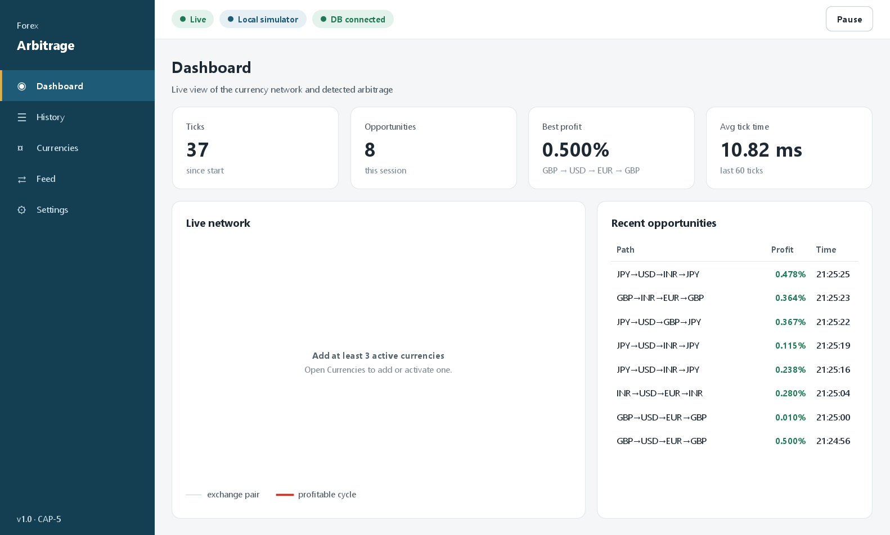
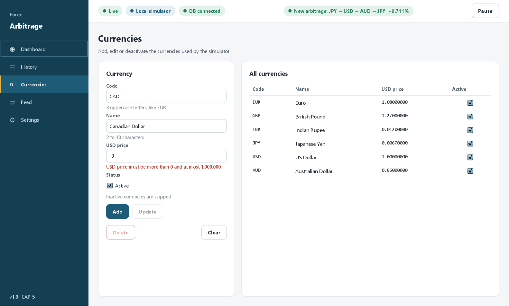
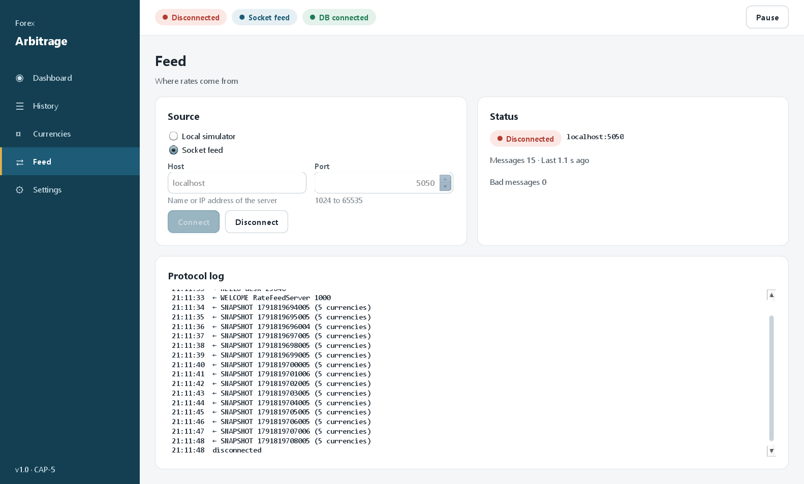
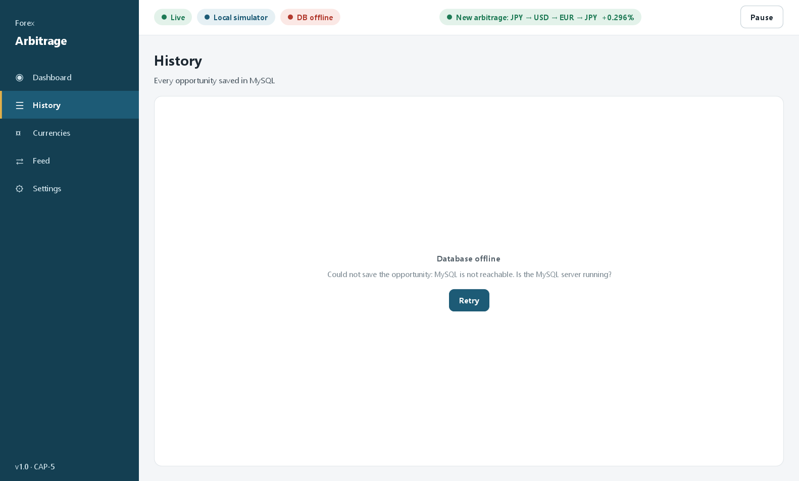

# User Manual

Two programs belong to this project:

- **Arbitrage Desktop** – the main window described in Parts 1 and 2.
- **Rate Feed Server** – a small second window described in Part 3.

How to install and start them is in the [README](../README.md).

---

## The main window

- **Sidebar (left):** click a name to open that screen. The current screen has a gold bar.
- **Top bar:** three status chips, a message area, and the **Pause** button.

| Chip | Meaning |
|---|---|
| `Live` (green) / `Paused` (amber) / `Disconnected` (red) | Whether rates are being analysed right now |
| `Local simulator` / `Socket feed` | Where the rates come from |
| `DB connected` (green) / `DB offline` (red) | Whether MySQL can be reached |

A green message such as `New arbitrage: INR → EUR → GBP → INR +0.347%` appears for 3 seconds
whenever a new opportunity is found.

---

# Part 1 – Phase I screens (CAP-3)

## 1. Dashboard

What you see:

- **Ticks** – how many rate snapshots were analysed since the app started (one per second).
- **Opportunities** – how many profitable loops were found in this session.
- **Best profit** – the highest profit so far and its path.
- **Avg tick time** – average time of the last 60 ticks.
- **Live network** – every active currency is a circle. Grey lines are exchange pairs.
  When a profitable loop is found, its arrows turn **red** for about 1.5 seconds, and each
  arrow shows its exchange rate.
- **Recent opportunities** – the 10 newest, with profit and time.

Steps:

1. Start the app and wait a few seconds: the first opportunity appears by itself.
2. Press **Pause** to freeze the picture and study it. The chip changes to `Paused`.
3. Press **Resume** to continue.

If fewer than 3 currencies are active, the graph shows *"Add at least 3 active currencies"*:

## 2. Currencies

**Add a currency**

1. Type the **Code** (3 uppercase letters, for example `AUD`), the **Name** and the **USD price**
   (the price of one unit in US dollars, for example `0.66`).
2. Leave **Active** ticked and press **Add**.
3. Open the Dashboard: the new currency is in the graph within a second.

**Change a currency**

1. Click its row in the table. The form fills in, and the code becomes read-only.
2. Change the name, the price or the Active box and press **Update**.

**Deactivate or delete**

- Untick **Active** and press **Update**: the row turns grey and the simulator skips it.
- Press **Delete** and confirm to remove it for good.
- `USD` is the base currency: it can never be deleted or deactivated.
- A currency that appears in saved history cannot be deleted. The message says
  *"Used in history – deactivate it instead"*.

**Clear** empties the form and removes the selection.

Mistakes are shown in red under the field:

## 3. Settings – Market

| Setting | Meaning | Allowed | Default |
|---|---|---|---|
| Fee % | Cost of every conversion | 0 – 5 % | 0.05 % |
| Spread % | Gap between the buy and sell rate | 0 – 2 % | 0.10 % |
| Inject chance % | How often the simulator adds a wrong rate | 0 – 100 % | 30 % |

1. Change a value. *"Unsaved changes"* appears next to the buttons.
2. Press **Save**. The new values are used from the next tick and are saved in MySQL.
3. **Reset defaults** puts the three default values back and saves them.

A value outside the allowed range is rejected with a red message under the field.
Try a fee of 1 %: no opportunities appear any more, because the fee eats the profit.

---

# Part 2 – Phase II screens (CAP-5)

## 4. History

Every opportunity is saved in MySQL together with its conversion steps (legs).

- **Filters:** choose a **Period**, a **Min profit %** and, if you like, a **Currency** code,
  then press **Apply**. **Reset** goes back to "Today, 0.00, any currency".
- **Summary line:** `128 opportunities · avg 0.41% · best 0.74%` for the current filters.
  The table shows at most the newest 500 rows.
- **Sort:** click a column header; click again for the other direction.
- **Details:** double-click a row to see its legs:

  

- **Delete selected:** select a row, press the button, confirm.
- **Clear all:** type `DELETE` in the box to remove every saved opportunity.

## 5. Feed

- **Local simulator** – rates are made inside the app. No network is needed.
- **Socket feed** – rates come from a Rate Feed Server.

Connect to a server:

1. Start the Rate Feed Server (Part 3) and press **Start server** there.
2. On the Feed screen choose **Socket feed**.
3. Type the **Host** (`localhost` for the same computer, or the IP address of the other
   computer) and the **Port** (default `5050`).
4. Press **Connect**. The status becomes `Connected` and the **Protocol log** shows the messages.
5. Press **Disconnect** (or choose **Local simulator**) to go back to the simulator.

The Status card shows how many messages arrived, how old the last one is, and how many bad
messages were ignored.

If the server stops, the status turns red and a dialog asks *"Switch to Local simulator?"*:

## 6. Settings – Database

The **Database** card shows the JDBC URL and the user from `application.properties`.
Press **Test connection**: it answers `Connected in 42 ms`, or says in plain words what is wrong.

## 7. When MySQL is not running

The app still starts and keeps detecting arbitrage in memory.

- The top bar shows a red `DB offline` chip.
- History and Currencies show this instead of their content:

  

- Start MySQL and press **Retry**. The tables are created if needed and the saved data loads.

---

# Part 3 – Rate Feed Server

1. Leave the **Port** at `5050` (or type another one from 1024 to 65535).
2. Press **Start server**. The chip shows `Running · 0 clients`.
3. Every desktop that connects appears under **Connected clients** with its name and address.
4. The **Log** shows who joined or left and every broadcast.
5. The bottom line counts the snapshots sent.
6. Press **Stop server** to say goodbye to all clients and close the port.

If the port is taken, the window says *"Port 5050 is already in use"*.
